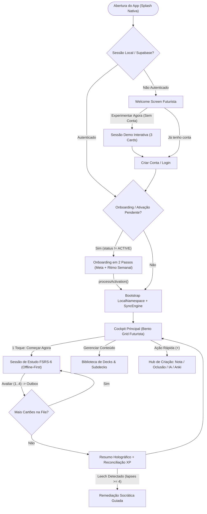
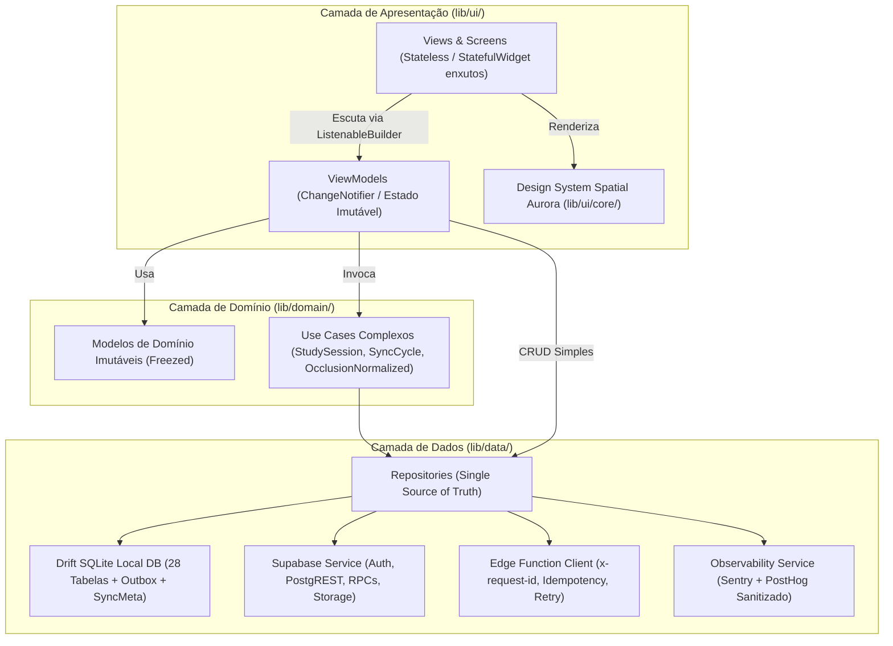

# SDD & Plano de Desenvolvimento — Flashi Mobile (Flutter APK & IPA)

**Versão:** 1.0 (Conversão Nativa Mobile Android & iOS)  
**Repositório de Origem Auditado:** `https://github.com/barrosrafa/app-flashi` (Next.js 16.1 + React 19 + Dexie + Supabase)  
**Contrato de Backend Fixo:** `https://github.com/barrosrafa/Flashi` (Supabase Postgres, RLS, 28 tabelas sincronizáveis, 12 Edge Functions, RPCs FSRS-6 e Storage Privado)  
**Workspace Alvo:** `/Users/rafaelaparecido/projects/flashcards-flutter`  
**Alvos de Compilação:** Android (`.apk` / `.aab`) e iOS (`.ipa`)

> [!IMPORTANT]
> **Princípio Inegociável da Conversão:** O backend Supabase (`barrosrafa/Flashi`) é tratado como **contrato imutável**. O aplicativo Flutter consome exatamente as mesmas 12 Edge Functions, 14+ RPCs, 28 tabelas de sincronização incremental por cursor monotônico `usn` e buckets privados (`card-media`, `anki-transfers`, `import-media`, `tts_cache`), elevando a experiência a um patamar **100% nativo, 60/120fps, offline-first em SQLite (Drift)** e com estética futurista **Spatial Aurora (Cyber-Glass)**.

---

## 1. Análise Competitiva de Mercado, Layout e Fluxo de Usabilidade

Para superar a versão web e os concorrentes móveis existentes, analisamos os 5 principais players globais de repetição espaçada sob a ótica de **ergonomia mobile (Thumb Zone), carga cognitiva, retenção de hábito e velocidade de revisão**.

### 1.1 Matriz de Benchmark Competitivo (Mobile Apps)

| Dimensão | AnkiMobile / AnkiDroid | Quizlet Mobile | RemNote Mobile | Mochi / Gizmo | **Flashi Flutter (Nosso Alvo Futurista)** |
|---|---|---|---|---|---|
| **Estética & Primeira Impressão** | Utilitária, datada, tabelas densas e menus de configuração intimidadores. | Colorida e amigável (Claymorphism/Flat), porém superficial para estudo pesado. | Densa como editor de notas; curva de aprendizado íngreme no celular. | Minimalista (Mochi) ou gamificada extrema (Gizmo). | **Spatial Aurora (Cyber-Glass):** Dark OLED profundo (`#05070E`), superfícies translúcidas em camadas, brilhos neon semânticos para estados de memória e foco absoluto no cartão. |
| **Ergonomia na Sessão de Estudo (Thumb Zone)** | Botões pequenos na base; difícil alcançar topo para ações secundárias com uma mão. | Swipe esquerda/direita ("Sei" / "Ainda aprendendo"), mas esconde os 4 níveis do FSRS. | Botões de avaliação na base, mas muita poluição visual no topo da tela. | Botões largos na base, bom uso de gestos. | **Ergonomia One-Handed Total:** Cartão centralizado com flip 3D físico + **Dock de Avaliação FSRS na Zona do Polegar** (4 botões grandes `>= 56dp` com preview do próximo intervalo + suporte opcional a *Swipe Gestures* com feedback háptico diferenciado). |
| **Onboarding & Ativação (Time-to-Value)** | Exige criar/importar deck antes de entender como funciona; tela vazia fria. | Permite testar sets públicos rápido, mas força paywall agressivo. | Setup longo de workspace antes da primeira revisão. | Onboarding rápido com quiz inicial. | **Fluxo "Demo-First" Instantâneo:** Da tela inicial direto para uma **Sessão Demo Interativa de 3 Cartões** (sem exigir login), seguida de criação guiada de conta → plano de estudo (2 passos) → primeiro deck/card. |
| **Transparência Offline & Sincronização** | Sync bloqueante modal ("Sincronizando...") que trava a UI. | Pouca transparência quando offline; falhas silenciosas. | Indicador de sync discreto, às vezes confuso sobre conflitos. | Bom modo offline local. | **Outbox Invisível + Pill Holográfico de Sync:** Estudo responde em `< 16ms` via SQLite (Drift). Um badge vivo no topo mostra `Online · Sincronizado`, `Offline · 100% Local` ou `Sincronizando (3)`, com *bottom sheet* detalhada para retry de itens em quarentena. |
| **Oclusão de Imagem & Mídia** | Exige add-on no desktop ou editor mobile pouco preciso no toque. | Oclusão limitada e paga. | Boa oclusão, mas difícil desenhar caixas com o dedo sem zoom. | Básica. | **Canvas Multi-Touch Nativo (`InteractiveViewer` + `CustomPainter`):** Pinça para zoom/pan com 2 dedos, arrasto com 1 dedo para desenhar/redimensionar máscaras em coordenadas percentuais canônicas (`0–100%`) e lupa de precisão ao arrastar cantos. |

### 1.2 Melhorias de Fluxo e Usabilidade Aplicadas ao Cliente

Baseado na auditoria de UX do próprio repositório (`docs/relatorio_ux_qa_benchmark.md` e `docs/ux-ui-audit.md`) e nas melhores práticas mobile:

1. **Arquitetura de Navegação "4 + Command Hub":**
   - Em vez de menus laterais complexos no celular, adotamos uma **Floating Glass Bottom Bar** com **4 destinos vitais**:
     1. `Painel` (`/dashboard` — cockpit diário com "Sua Próxima Sessão" em destaque)
     2. `Estudar` (`/study` — entrada direta na fila inteligente com filtro de Exames)
     3. `Decks` (`/decks` — biblioteca hierárquica + busca rápida)
     4. `Criar / IA` (`/create` — modal/hub rápido para Novo Card, Oclusão de Imagem, Ingestão IA de PDF/YouTube/Texto ou Importar Anki `.apkg`)
   - O 5º ícone abre o **Command Hub ("Mais")**, um *DraggableScrollableSheet* em vidro fosco agrupado por intenção (*Acompanhar: Analytics, Exames, Conquistas, Leaderboard*, *Ferramentas: Busca Semântica, Templates, Mídia, Remediação Socrática, MCP*, *Conta: Perfil, Plano de Estudos, Otimizador FSRS*).
2. **Modo Imersivo "Zero-Distraction" no Estudo:**
   - Ao entrar em `/study/:deckId`, a Bottom Navigation Bar recolhe suavemente.
   - O topo exibe apenas uma barra de progresso contínua luminosa (`4px`), contador `12 de 40`, badge de prioridade de exame (se ativo, ex: *"🔥 Residência Médica · faltam 5 dias"*) e botão de alternância `Modo Foco OLED / Modo Leitura Claro`.
3. **Feedback Háptico e Semântico nas 4 Respostas FSRS-6:**
   - O cartão só libera as 4 avaliações (**1. De novo**, **2. Difícil**, **3. Bom**, **4. Fácil**) **após** a revelação da resposta (prevenindo toque acidental).
   - Cada botão possui cor semântica própria, ícone/atalho e vibração tátil distinta (`HapticFeedback.heavyImpact()` em *De novo*, `lightImpact()` em *Bom/Fácil*).
4. **Liquidação Assíncrona de Sessão e Celebração Gamificada:**
   - Ao concluir o último cartão, a tela de resumo aparece **imediatamente** com animação de partículas neon, precisão da sessão, tempo médio por cartão e status em tempo real da reconciliação do XP (`sync_session_xp_confirmed`), sem travar o usuário caso esteja no metrô sem internet.



---

## 2. Design System Futurista: "Flashi Spatial Aurora (Cyber-Glass)"

Evoluímos o sistema `flashi-aurora` original do repositório (`design-system/flashi-aurora/MASTER.md`) para uma linguagem **Spatial Glassmorphism & Dark OLED** otimizada para telas Super Retina XDR (iOS) e AMOLED 120Hz (Android), mantendo 100% de conformidade com contraste WCAG 2.2 AA.

### 2.1 Paleta de Cores e Tokens Semânticos (`FlashiThemeTokens`)

| Papel Semântico | Token Flutter | Modo Escuro (Padrão Futurista OLED) | Modo Claro (Conforto Diurno) | Aplicação Visual |
|---|---|---|---|---|
| **Fundo Abissal** | `bgCanvas` | `#05070E` | `#F8FAFC` | Fundo global das telas; economiza bateria em OLED e destaca o vidro. |
| **Superfície Primária** | `bgSurface` | `#0B1020` | `#FFFFFF` | Cards base, containers de listas e modais. |
| **Superfície Glass (Elevada)** | `bgGlass` | `rgba(17, 24, 39, 0.68)` + `Blur(20)` | `rgba(255, 255, 255, 0.82)` + `Blur(20)` | Bottom bar flutuante, HUD de estudo, cards Bento em destaque. |
| **Borda Especular** | `borderSubtle` | `#1E293B` (ou gradiente branco `12%`→`3%`) | `#E2E8F0` | Contorno de `1.0px` simulando refração de luz no vidro. |
| **Borda de Foco / Ativa** | `borderGlow` | `#818CF8` (com sombra `blur: 12`) | `#4F46E5` | Inputs focados, cartão selecionado, máscara de oclusão ativa. |
| **Ação Principal (Cyber Indigo)** | `primary` | `#6366F1` → `#818CF8` | `#4F46E5` | Botões primários, revelar resposta, indicadores ativos. |
| **Acento Neural (Violet Pulse)** | `accent` | `#A78BFA` | `#8B5CF6` | IA Ingest, busca semântica, badges de nível e XP. |
| **Acento Foco (Cyan Matrix)** | `cyanAccent` | `#22D3EE` | `#0891B2` | Indicador de sincronização USN, oclusão de imagem, modo exame. |
| **Texto Principal** | `textPrimary` | `#F8FAFC` | `#0F172A` | Perguntas/respostas dos cartões, títulos `H1`/`H2`. |
| **Texto Secundário** | `textSecondary` | `#CBD5E1` | `#475569` | Subtítulos, descrições de decks, metadados de fila. |
| **Texto Auxiliar / Muted** | `textMuted` | `#94A3B8` | `#64748B` | Rótulos `eyebrow`, timestamps, dicas de atalho. |
| **Rating 1: De Novo (Again)** | `ratingAgain` | `#FB7185` (Fundo `#4C0519` `40%`) | `#DC2626` | Lapso de memória / Reaprendizagem imediata. |
| **Rating 2: Difícil (Hard)** | `ratingHard` | `#FBBF24` (Fundo `#451A03` `40%`) | `#9A6700` | Lembrança com esforço alto. |
| **Rating 3: Bom (Good)** | `ratingGood` | `#34D399` (Fundo `#064E3B` `40%`) | `#047857` | Ritmo ideal de retenção FSRS (Sucesso). |
| **Rating 4: Fácil (Easy)** | `ratingEasy` | `#38BDF8` (Fundo `#0C4A6E` `40%`) | `#0284C7` | Salto de estabilidade elevado. |

### 2.2 Tipografia e Escala Espacial

- **Família de Títulos e HUD (`Space Grotesk`):** Geométrica, tecnológica, com `FontFeature.tabularFigures()` ativado em todos os contadores de cartões, cronômetros, porcentagens de retenção e XP para evitar *layout shift* durante animações.
- **Família de Leitura e Corpo (`DM Sans`):** Altíssima legibilidade para enunciados longos de cartões, altura de linha generosa (`height: 1.55`), tamanho mínimo de `18sp` na pergunta do flashcard.
- **Família Técnica (`JetBrains Mono`):** Usada em badges de intervalo FSRS (`+4d`, `15m`), hashes SHA-256, auditoria MCP e status de cursor USN.

### 2.3 Componentes Futuristas Assinatura (Core Widgets)

1. **`AuroraBackgroundScaffold`:** Fundo em `#05070E` com duas esferas de luz difusa posicionadas nos cantos (`RadialGradient` Indigo `#4F46E5` com opacidade `0.14` no topo direito e Violet `#8B5CF6` com opacidade `0.10` na base esquerda), isoladas em um `RepaintBoundary` estático (custo zero de GPU durante o scroll).
2. **`GlassBentoCard`:** Card modular com `ClipRRect(borderRadius: BorderRadius.circular(20))`, `BackdropFilter` (ou fallback sólido de alta performance quando `disableAnimations` estiver ativo), borda gradiente diagonal de `1px` e micro-animação de escala (`0.985`) ao toque.
3. **`Flashi3DStudyCard`:** Cartão de estudo com perspectiva 3D (`Matrix4.identity()..setEntry(3, 2, 0.001)..rotateY(...)`) para virar frente/verso ou transição *Cross-Fade Axial* quando o cartão contém imagem ocluída, mais halo sutil que muda de cor conforme o usuário desliza o cartão.
4. **`SyncPulseOrb`:** Indicador compacto no cabeçalho que pulsa em ciano durante o ciclo `runSyncCycle()`, fica verde esmeralda quando `pending == 0`, âmbar quando `offline` (com contagem local preservada) e rosa quando há item que requer atenção na `outbox`.

---

## 3. Arquitetura Técnica Flutter (Clean MVVM + Offline-First)

Seguindo as diretrizes oficiais de arquitetura Flutter (`UI Layer -> Domain Layer -> Data Layer`), estruturamos o projeto para máxima testabilidade, separação estrita de responsabilidades e execução **100% offline-first**.



### 3.1 Decisões de Engenharia Mobile (Equivalências Web → Flutter)

| Subsistema no `app-flashi` (Web) | Equivalente Nativo no `flashcards-flutter` | Justificativa Técnica |
|---|---|---|
| **Dexie.js (IndexedDB)** (`lib/db/schema.ts`) | **Drift (SQLite Nativo via FFI / `drift_flutter`)** | IndexedDB não existe nativamente fora de WebViews. O **Drift** roda sobre SQLite C nativo em Background Isolate, suporta transações ACID multi-tabela para o `executeIncrementalSync()`, consultas indexadas em `< 2ms` e migrações tipadas. |
| **`localStorage` Namespace Lock** (`lib/db/local-user-scope.ts`) | **`LocalUserScopeManager` (Mutex Dart + `FlutterSecureStorage` + Drift Transaction)** | Garante que a troca de conta limpe imediatamente todas as 27 tabelas de cache local preservando intacta a tabela `outbox` particionada por `user_id`. |
| **`navigator.onLine` + Event Listeners** | **`connectivity_plus` + `AppLifecycleListener`** | Dispara `runSyncCycle()` automaticamente quando o celular recupera sinal (Wi-Fi/5G) ou quando o app volta do background (`AppLifecycleState.resumed`). |
| **`invokeEdge<T>`** (`lib/services/http/edge-client.ts`) | **`EdgeFunctionClient` (`supabase.functions.invoke`)** | Mantém timeout com `Future.timeout`, cabeçalhos `x-request-id` e `idempotency-key`, backoff exponencial (`2^attempt * 300ms`) apenas para chamadas `isReadOnly` ou `(isIdempotent && idempotencyKey != null)`, e emissão global no `EdgeErrorBus`. |
| **XState `activationMachine`** (`lib/activation-machine.ts`) | **`ActivationStateMachine` (Sealed Classes Dart 3 + `ValueNotifier`)** | Máquina de estados determinística nativa (`Pending`, `Validating`, `Active`, `Suspended`, `Failed`) sem dependências externas pesadas. |
| **KaTeX & Markdown nos Cartões** | **`flutter_math_fork` + `flutter_markdown`** | Renderiza equações LaTeX e formatação rica diretamente na árvore de RenderObjects do Flutter a 120fps, funcionando 100% offline. |
| **Upload SHA-256 & `.apkg` / PDF** | **`crypto` (Dart) + `file_picker` + `image_picker`** | Calcula SHA-256 em Isolate (`compute`) para arquivos de até 50 MiB (`.apkg`) ou 25 MiB (mídia) sem travar a UI thread. |

---

## 4. Contrato Completo de Dados, Sync USN e Outbox no Flutter

### 4.1 As 28 Tabelas Sincronizáveis no SQLite Local (Drift)

No `app-flashi/lib/db/schema.ts` (versão 5 do Dexie), o banco local armazena um espelho JSON flexível com índices chaves para suportar todas as entidades emitidas pela Edge Function `sync` (`get_incremental_sync`). No Flutter (Drift), implementamos uma arquitetura **Híbrida Tipada + Tabela de Entidades Sincronizadas**:
- **Tabelas Fortemente Tipadas (Hot Path de Estudo e Offline):**
  1. `decks` (`id`, `user_id`, `name`, `description`, `parent_deck_id`, `visibility`, `is_archived`, `study_config`, `deleted_at`, `usn`, `updated_at`)
  2. `notes` (`id`, `deck_id`, `user_id`, `template_id`, `fields_json`, `tags_json`, `source`, `source_format`, `deleted_at`, `usn`, `updated_at`)
  3. `cards` (`id`, `deck_id`, `note_id`, `user_id`, `template_id`, `fields_json`, `card_kind`, `card_ordinal`, `cloze_ordinal`, `is_suspended`, `is_archived`, `deleted_at`, `usn`, `updated_at`)
  4. `card_learning_state` (`card_id`, `user_id`, `state`, `due_at`, `interval_days`, `stability`, `difficulty`, `retrievability`, `lapses`, `is_suspended`, `algorithm`, `usn`, `updated_at`)
  5. `review_logs` (`id`, `card_id`, `user_id`, `rating`, `reviewed_at`, `time_spent_ms`, `client_review_id`, `session_id`, `usn`, `server_confirmed`, `server_review_id`, `server_state`, `server_due_at`, `server_interval_days`, `confirmed_at`)
  6. `deck_exams` (`id`, `user_id`, `deck_id`, `exam_name`, `target_date`, `priority_level`, `status`, `usn`, `updated_at`)
  7. `card_templates` (`id`, `user_id`, `name`, `is_system`, `field_definitions_json`, `card_generation_json`, `usn`, `updated_at`)
  8. `tags` & `card_tags` (`id`, `user_id`, `name`, `color`, `usn` / `card_id`, `tag_id`)
  9. `card_media` & `note_image_occlusion_boxes` (`id`, `card_id`, `note_id`, `storage_bucket`, `storage_path`, `media_type`, `mime_type`, `file_size_bytes`, `sha256_hash`, `usn` / `id`, `note_id`, `cloze_ordinal`, `x_pos`, `y_pos`, `width_pct`, `height_pct`, `label_text`, `usn`)
  10. `outbox_mutations` (`id`, `user_id`, `table_name`, `action`, `rpc_name`, `transport`, `payload_json`, `client_mutation_id`, `created_at`, `retries`, `last_error`, `quarantined`, `next_attempt_at`)
  11. `sync_meta` (`key`, `user_id`, `value`) — armazena `last_usn:<userId>` e snapshots de fila offline `due-queue:<deckId>:<mode>`.
- **Tabelas Complementares do `SYNC_TABLES` (Armazenadas em `synced_entities` indexada por `(table_name, id, user_id, usn)` ou tabelas dedicadas):**
  - `note_card_definitions`, `note_cloze_deletions`, `note_references`, `field_definitions`, `study_settings`, `user_deck_settings`, `daily_statistics`, `fsrs_optimization_runs`, `deck_collaborators`, `user_gamification_profiles`, `user_badges`, `badges_definition`, `socratic_remediation_sessions`, `ai_ingestion_jobs`, `anki_transfer_jobs`, `profiles`, `mcp_tool_audit`.

### 4.2 Regras Críticas de Paridade com o Backend

1. **Comparação de Cursor USN com `BigInt`:**
   - Assim como em `lib/db/sync-engine.ts`, o `usn` nunca deve ser comparado como `double` ou `int` de 32 bits; usamos `BigInt.parse(usn.toString())` e só gravamos `last_usn:<userId>` **ao final da transação** de cada página de até 500 registros (máximo de 20 páginas por ciclo).
2. **Idempotência de Revisão (`fsrs-review`) e XP (`sync_session_xp_confirmed`):**
   - Toda avaliação gera um `client_review_id` (UUID v4) único.
   - A mutação `sync_session_xp_confirmed` na `outbox` **aguarda (`deferred`)** caso ainda exista qualquer item em `outbox_mutations` com `table_name == 'review_logs'` e o mesmo `session_id` pendente para aquele usuário.
3. **Criação Atômica de Notas e Cards (`mcp_create_note`):**
   - Nunca fazer `insert` separado em `notes` e `cards`, pois `get_due_cards` exige que o cartão possua linha em `card_learning_state`. Toda criação de nota/card chama a RPC `mcp_create_note`, que inicializa `card_learning_state` transacionalmente.
4. **Coordenadas Canônicas de Oclusão (`0–100%`):**
   - O editor de oclusão em Flutter converte o toque na imagem (`localPosition.dx / imageRenderWidth * 100`) para percentual com precisão de 3 casas decimais (`(val * 1000).round() / 1000`), validando `x >= 0`, `y >= 0`, `w > 0`, `h > 0`, `x + w <= 100`, `y + h <= 100`.

---

## 5. Estrutura Completa do Projeto e Catálogo de Arquivos a Criar/Alterar

Abaixo está o mapeamento exaustivo de **todos os 112 arquivos** que compõem a aplicação Flutter em `/Users/rafaelaparecido/projects/flashcards-flutter`, relacionando cada um ao arquivo original do `app-flashi` e detalhando sua implementação.

### 5.1 Árvore de Diretórios Completa

```text
flashcards-flutter/
├── pubspec.yaml
├── analysis_options.yaml
├── .env.example
├── android/
│   └── app/
│       ├── build.gradle.kts
│       ├── proguard-rules.pro
│       └── src/main/AndroidManifest.xml
├── ios/
│   ├── Podfile
│   ├── ExportOptions.plist
│   └── Runner/
│       ├── Info.plist
│       └── Runner.entitlements
├── assets/
│   ├── fonts/                       # SpaceGrotesk, DMSans, JetBrainsMono
│   ├── icons/                       # flashi.svg, app_icon_1024.png
│   └── l10n/                        # pt-BR.json, en.json, es.json (migrados de locales/)
├── lib/
│   ├── main.dart
│   ├── app.dart
│   ├── core/
│   │   ├── config/
│   │   │   ├── env_config.dart
│   │   │   └── feature_flags.dart
│   │   ├── constants/
│   │   │   └── storage_buckets.dart
│   │   ├── di/
│   │   │   └── service_locator.dart
│   │   ├── errors/
│   │   │   ├── app_exceptions.dart
│   │   │   └── edge_error_bus.dart
│   │   ├── l10n/
│   │   │   └── app_localizations.dart
│   │   ├── observability/
│   │   │   ├── analytics_events.dart
│   │   │   ├── observability_service.dart
│   │   │   └── privacy_sanitizer.dart
│   │   ├── router/
│   │   │   ├── app_router.dart
│   │   │   └── route_guards.dart
│   │   └── utils/
│   │       ├── crypto_utils.dart
│   │       ├── date_range_bounds.dart
│   │       ├── haptics_helper.dart
│   │       └── validators.dart
│   ├── data/
│   │   ├── local/
│   │   │   ├── app_database.dart
│   │   │   ├── tables/
│   │   │   │   ├── core_tables.dart
│   │   │   │   └── sync_tables.dart
│   │   │   ├── local_user_scope.dart
│   │   │   ├── offline_identity.dart
│   │   │   ├── outbox_queue.dart
│   │   │   ├── sync_engine.dart
│   │   │   └── telemetry_recorder.dart
│   │   ├── remote/
│   │   │   ├── supabase_client_provider.dart
│   │   │   ├── edge_function_client.dart
│   │   │   └── mcp_external_client.dart
│   │   └── repositories/
│   │       ├── auth_repository.dart
│   │       ├── activation_repository.dart
│   │       ├── onboarding_repository.dart
│   │       ├── dashboard_repository.dart
│   │       ├── deck_repository.dart
│   │       ├── deck_settings_repository.dart
│   │       ├── collaborator_repository.dart
│   │       ├── note_repository.dart
│   │       ├── card_repository.dart
│   │       ├── study_repository.dart
│   │       ├── template_repository.dart
│   │       ├── tag_repository.dart
│   │       ├── reference_repository.dart
│   │       ├── media_repository.dart
│   │       ├── occlusion_repository.dart
│   │       ├── search_repository.dart
│   │       ├── ingestion_repository.dart
│   │       ├── import_deck_repository.dart
│   │       ├── anki_repository.dart
│   │       ├── exam_repository.dart
│   │       ├── gamification_repository.dart
│   │       ├── socratic_repository.dart
│   │       ├── optimizer_repository.dart
│   │       ├── analytics_repository.dart
│   │       ├── profile_repository.dart
│   │       └── mcp_repository.dart
│   ├── domain/
│   │   ├── models/
│   │   │   ├── deck.dart
│   │   │   ├── note.dart
│   │   │   ├── flashcard.dart
│   │   │   ├── due_card.dart
│   │   │   ├── review_result.dart
│   │   │   ├── card_template.dart
│   │   │   ├── occlusion_mask.dart
│   │   │   ├── deck_exam.dart
│   │   │   ├── gamification.dart
│   │   │   ├── socratic_session.dart
│   │   │   ├── ingestion_job.dart
│   │   │   ├── anki_transfer.dart
│   │   │   ├── analytics_summary.dart
│   │   │   ├── learning_preferences.dart
│   │   │   └── user_profile.dart
│   │   └── services/
│   │       ├── template_renderer.dart
│   │       ├── note_card_fields_deriver.dart
│   │       └── activation_state_machine.dart
│   └── ui/
│       ├── core/
│       │   ├── theme/
│       │   │   ├── flashi_color_tokens.dart
│       │   │   ├── flashi_typography.dart
│       │   │   ├── flashi_theme.dart
│       │   │   └── theme_controller.dart
│       │   └── widgets/
│       │       ├── aurora_scaffold.dart
│       │       ├── glass_bento_card.dart
│       │       ├── cyber_primary_button.dart
│       │       ├── app_shell_navigation.dart
│       │       ├── sync_status_orb_panel.dart
│       │       ├── edge_error_banner.dart
│       │       ├── rate_limit_banner.dart
│       │       └── futuristic_form_field.dart
│       └── features/
│           ├── landing/
│           │   └── views/welcome_landing_screen.dart
│           ├── auth/
│           │   ├── view_models/auth_view_model.dart
│           │   └── views/
│           │       ├── login_screen.dart
│           │       ├── register_screen.dart
│           │       ├── forgot_password_screen.dart
│           │       └── reset_password_screen.dart
│           ├── onboarding/
│           │   ├── view_models/onboarding_view_model.dart
│           │   └── views/
│           │       ├── onboarding_screen.dart
│           │       └── activation_screen.dart
│           ├── dashboard/
│           │   ├── view_models/dashboard_view_model.dart
│           │   └── views/
│           │       ├── dashboard_screen.dart
│           │       └── widgets/
│           │           ├── next_session_hero_card.dart
│           │           ├── rhythm_bento_grid.dart
│           │           └── learning_plan_banner.dart
│           ├── study/
│           │   ├── view_models/study_session_view_model.dart
│           │   └── views/
│           │       ├── study_hub_screen.dart
│           │       ├── study_session_screen.dart
│           │       ├── study_search_screen.dart
│           │       └── widgets/
│           │           ├── flashi_3d_card_view.dart
│           │           ├── fsrs_rating_dock.dart
│           │           ├── occlusion_study_card.dart
│           │           └── session_summary_sheet.dart
│           ├── decks/
│           │   ├── view_models/
│           │   │   ├── deck_library_view_model.dart
│           │   │   └── deck_detail_view_model.dart
│           │   └── views/
│           │       ├── deck_library_screen.dart
│           │       ├── new_deck_screen.dart
│           │       ├── deck_detail_screen.dart
│           │       └── widgets/
│           │           ├── deck_settings_sheet.dart
│           │           └── collaborator_manager_sheet.dart
│           ├── cards_notes/
│           │   ├── view_models/
│           │   │   ├── card_browser_view_model.dart
│           │   │   └── note_workspace_view_model.dart
│           │   └── views/
│           │       ├── deck_cards_screen.dart
│           │       ├── deck_notes_screen.dart
│           │       └── widgets/
│           │           ├── tag_selector_chips.dart
│           │           └── reference_editor_sheet.dart
│           ├── occlusion/
│           │   ├── view_models/occlusion_editor_view_model.dart
│           │   └── views/
│           │       ├── occlusion_hub_screen.dart
│           │       ├── new_occlusion_screen.dart
│           │       └── widgets/occlusion_interactive_canvas.dart
│           ├── templates/
│           │   ├── view_models/templates_view_model.dart
│           │   └── views/
│           │       ├── templates_list_screen.dart
│           │       ├── template_detail_screen.dart
│           │       └── template_edit_screen.dart
│           ├── search/
│           │   ├── view_models/search_view_model.dart
│           │   └── views/search_workspace_screen.dart
│           ├── imports_exports/
│           │   ├── view_models/imports_view_model.dart
│           │   └── views/
│           │       ├── import_anki_screen.dart
│           │       ├── export_anki_screen.dart
│           │       ├── import_deck_file_screen.dart
│           │       ├── import_url_screen.dart
│           │       ├── ai_ingest_screen.dart
│           │       └── widgets/worker_job_monitor_card.dart
│           ├── exams/
│           │   ├── view_models/exams_view_model.dart
│           │   └── views/exams_scheduler_screen.dart
│           ├── analytics/
│           │   ├── view_models/analytics_view_model.dart
│           │   └── views/analytics_screen.dart
│           ├── gamification/
│           │   ├── view_models/gamification_view_model.dart
│           │   └── views/
│           │       ├── leaderboard_screen.dart
│           │       └── badges_screen.dart
│           ├── socratic/
│           │   ├── view_models/socratic_view_model.dart
│           │   └── views/
│           │       ├── socratic_list_screen.dart
│           │       └── socratic_session_screen.dart
│           ├── media/
│           │   ├── view_models/media_manager_view_model.dart
│           │   └── views/media_detail_screen.dart
│           ├── tools/
│           │   ├── view_models/mcp_view_model.dart
│           │   └── views/
│           │       ├── tools_hub_screen.dart
│           │       └── mcp_console_screen.dart
│           └── profile_settings/
│               ├── view_models/profile_view_model.dart
│               └── views/
│                   ├── profile_screen.dart
│                   ├── learning_plan_screen.dart
│                   └── fsrs_optimize_screen.dart
└── test/
    ├── data/
    │   ├── sync_engine_test.dart
    │   ├── outbox_queue_test.dart
    │   └── local_user_scope_test.dart
    ├── domain/
    │   ├── template_renderer_test.dart
    │   ├── occlusion_mask_test.dart
    │   └── onboarding_state_test.dart
    └── ui/
        ├── study_session_widget_test.dart
        └── dashboard_widget_test.dart
```

---

### 5.2 Detalhamento Arquivo por Arquivo (Especificação de Implementação)

#### A. Configuração Raiz e Nativa (`pubspec.yaml`, `android/`, `ios/`)

| Arquivo a Criar/Alterar | Origem no `app-flashi` | Especificação Detalhada do Conteúdo |
|---|---|---|
| `pubspec.yaml` | `package.json` | Define SDK Dart `>=3.5.0 <4.0.0`. Dependências principais: `supabase_flutter: ^2.8.0`, `drift: ^2.22.0`, `drift_flutter: ^0.2.0`, `sqlite3_flutter_libs: ^0.5.26`, `path_provider: ^2.1.5`, `flutter_secure_storage: ^9.2.2`, `go_router: ^14.6.0`, `provider: ^6.1.2`, `get_it: ^8.0.2`, `freezed_annotation: ^2.4.4`, `json_annotation: ^4.9.0`, `crypto: ^3.0.6`, `uuid: ^4.5.1`, `connectivity_plus: ^6.1.0`, `file_picker: ^8.1.4`, `image_picker: ^1.1.2`, `cached_network_image: ^3.4.1`, `flutter_math_fork: ^0.7.3`, `flutter_markdown: ^0.7.4`, `fl_chart: ^0.69.2`, `google_fonts: ^6.2.1`, `lucide_icons_flutter: ^1.2.4`, `sentry_flutter: ^8.11.0`, `posthog_flutter: ^4.7.0`, `intl: ^0.19.0`, `share_plus: ^10.1.2`, `url_launcher: ^6.3.1`. DevDependencies: `build_runner`, `drift_dev`, `freezed`, `json_serializable`, `mockito`, `flutter_launcher_icons`, `flutter_native_splash`. |
| `android/app/build.gradle.kts` | N/A (Nativo Android) | Configura `applicationId = "io.flashi.app"`, `minSdk = 24` (Android 7.0+), `targetSdk = 35`, `compileSdk = 35`. Configura `signingConfigs.release` lendo `key.properties`, habilita `isMinifyEnabled = true` e `isShrinkResources = true` com `proguard-rules.pro` (preservando classes do SQLite/Drift e Sentry). |
| `android/app/src/main/AndroidManifest.xml` | `app/manifest.ts` | Declara permissões: `INTERNET`, `ACCESS_NETWORK_STATE`, `VIBRATE`, `READ_MEDIA_IMAGES` (opcional para oclusão). Configura `<intent-filter>` para Deep Link de autenticação e reset de senha (`io.flashi.app://auth-callback` e App Links HTTPS para `flashi.app`). |
| `ios/Runner/Info.plist` | `app/manifest.ts` | Configura `CFBundleDisplayName = "Flashi"`, `CFBundleURLTypes` com esquema `io.flashi.app`, `NSPhotoLibraryUsageDescription` ("Necessário para enviar imagens para seus flashcards e criar oclusões de imagem"), `NSCameraUsageDescription` ("Necessário para fotografar cadernos e apostilas para seus flashcards"), `UIBackgroundModes` (`fetch`, `processing`) e `CADisableMinimumFrameDurationOnPhone = true` (ativa 120Hz ProMotion nos iPhones Pro). |
| `ios/ExportOptions.plist` | N/A (Build IPA) | Define `method` (`app-store-connect` ou `ad-hoc`), `teamID`, `signingStyle = automatic`, `uploadBitcode = false`, ` uploadSymbols = true` para geração direta do `.ipa` via `flutter build ipa`. |

#### B. Camada `lib/core/` (Infraestrutura, Roteamento, Observabilidade e Segurança)

| Arquivo a Criar | Origem no `app-flashi` | Responsabilidade, Classes e Assinaturas |
|---|---|---|
| `lib/core/config/env_config.dart` | `.env.example`, `lib/site-url.ts` | Classe `EnvConfig` lendo via `String.fromEnvironment` (`--dart-define-from-file=.env`): `supabaseUrl`, `supabaseAnonKey` (`sb_publishable_...`), `sentryDsn`, `posthogApiKey`, `posthogHost`, `siteUrl`. Inclui getter `bool get isSupabaseConfigured`. **Jamais** inclui `service_role` ou `OPENAI_API_KEY`. |
| `lib/core/config/feature_flags.dart` | `lib/feature-flags.ts` | Enum `FeatureFlag { media, semantic, anki, ankiIo, aiIngest, gamification, collab, fsrsOpt, exams, occlusion, syncWorker, tags, socratic, templates, references }`. Função `bool isFeatureEnabled(FeatureFlag flag) => true;` mantendo 100% das features ativas no build final. |
| `lib/core/errors/app_exceptions.dart` | `lib/services/http/errors.ts` | Classes tipadas de erro: `AuthRequiredError`, `EdgeError(fnName, status, message, payload)`, `EdgeTimeoutError`, `RateLimitError(fnName, retryAfterSeconds, payload)`, `UnavailableError`, `OcclusionRpcError`, `MediaServiceError`. |
| `lib/core/errors/edge_error_bus.dart` | `lib/services/http/event-bus.ts` | Singleton `EdgeErrorBus extends ChangeNotifier` que expõe `EdgeError? latestError`, `RateLimitError? activeRateLimit`, `void emit(Object error)` e `void clear()`. Alimenta os banners globais `EdgeErrorBanner` e `RateLimitBanner`. |
| `lib/core/observability/analytics_events.dart` | `lib/observability/events.ts` | Define os 25 eventos estritos (`page_viewed`, `ui_interaction`, `client_error`, `api_request_started`, `api_request_completed`, `supabase_request_completed`, `signup_started`, `signup_completed`, `login_succeeded`, `login_failed`, `activation_viewed`, `activation_submitted`, `activation_completed`, `activation_failed`, `sync_started`, `sync_completed`, `sync_failed`, `study_session_started`, `card_rated`, `study_session_completed`, `deck_created`, `card_created`, `ai_generation_started`, `ai_generation_completed`, `ai_generation_failed`), além de `weeklyMinutesBucket()` e `normalizeErrorCode()`. |
| `lib/core/observability/privacy_sanitizer.dart` | `lib/observability/privacy.ts` | Remove recursivamente chaves proibidas (`token`, `authorization`, `cookie`, `email`, `password`, `front`, `back`, `fields`, `prompt`, `content`, `idempotency_key`) antes de enviar eventos ao Sentry ou PostHog. |
| `lib/core/observability/observability_service.dart` | `lib/observability/{sentry,posthog,index}.ts` | Encapsula `SentryFlutter` e `Posthog()`. Expõe `capture(event, props)`, `captureException(error, stackTrace, {tags, extra})`, `identifyUser(userId)`, `resetAnalytics()`, e um `NavigatorObserver` customizado (`FlashiRouteObserver`) que dispara `page_viewed` automaticamente a cada troca de rota no `GoRouter`. |
| `lib/core/l10n/app_localizations.dart` | `contexts/LanguageContext.tsx`, `locales/{pt-BR,en,es}.json` | Carrega os dicionários JSON (`pt-BR`, `en`, `es`) e os mapas de `autoTranslations.ts` / `featureTranslations.ts`. Expõe `String t(String key)` e `LocaleController extends ChangeNotifier` persistindo o idioma escolhido. |
| `lib/core/router/app_router.dart` | `app/**/page.tsx` (todas as 38 rotas) | Configura `GoRouter` com `StatefulShellRoute.indexedStack` para as 4 abas principais (`/dashboard`, `/study`, `/decks`, `/decks/new`) e sub-rotas completas (`/login`, `/register`, `/forgot-password`, `/reset-password`, `/onboarding`, `/activation`, `/study/:deckId`, `/study/search`, `/decks/:deckId`, `/decks/:deckId/cards`, `/decks/:deckId/notes`, `/decks/:deckId/occlusion/new`, `/occlusion`, `/templates`, `/templates/:id`, `/templates/:id/edit`, `/search`, `/import/anki`, `/export/anki`, `/import/deck`, `/import/url`, `/import/ai-ingest`, `/exams`, `/analytics`, `/leaderboard`, `/profile`, `/profile/learning-plan`, `/profile/badges`, `/socratic`, `/socratic/:id`, `/media/:id`, `/tools`, `/tools/mcp`, `/settings/fsrs-optimize`). |
| `lib/core/router/route_guards.dart` | `proxy.ts`, `lib/onboarding-gate.ts` | Redireciona rotas protegidas para `/login` quando não autenticado (exceto `/study/demo` e rotas públicas), e redireciona para `/onboarding` caso `OnboardingRepository.isOnboardingRequired()` seja verdadeiro. |
| `lib/core/utils/crypto_utils.dart` | `lib/services/media-service.ts` | Função `Future<String> computeFileSha256(File file)` executada em `Isolate.run` usando `package:crypto` para gerar hash hexadecimal de 64 caracteres sem bloquear a UI. |
| `lib/core/utils/haptics_helper.dart` | Novo (Upgrade Mobile Nativo) | Wrapper sobre `HapticFeedback` com métodos semânticos: `onCardFlip()`, `onRateAgain()`, `onRateHard()`, `onRateGood()`, `onRateEasy()`, `onSessionComplete()`, `onError()`. Respeita preferências do sistema. |

#### C. Camada `lib/data/` (Banco Local Drift, Motor de Sync USN, Outbox e Clientes Remotos)

| Arquivo a Criar | Origem no `app-flashi` | Responsabilidade, Classes e Assinaturas |
|---|---|---|
| `lib/data/local/tables/core_tables.dart` | `lib/db/schema.ts` | Declara as tabelas Drift: `LocalDecks`, `LocalNotes`, `LocalCards`, `LocalLearningStates`, `LocalReviews`, `LocalExams`, `LocalTemplates`, `LocalProfiles`, `LocalMcpAudits`, `OutboxMutations`, `SyncMetaEntries`. |
| `lib/data/local/tables/sync_tables.dart` | `lib/db/schema.ts` (`SYNC_TABLES`) | Declara a constante `kSyncTables` com os 28 nomes exatos de tabelas sincronizáveis e a tabela Drift `SyncedEntitiesTable` (`tableName`, `id`, `userId`, `deckId`, `usn`, `updatedAt`, `deletedAt`, `payloadJson`, `dirty`, `syncedAt`) para armazenar e consultar com velocidade qualquer entidade do ciclo incremental. |
| `lib/data/local/app_database.dart` | `lib/db/schema.ts` (`FlashiDB`) | Classe `@DriftDatabase` `FlashiLocalDatabase` com `schemaVersion => 5`, índices compostos (`(user_id, usn)`, `(deck_id, deleted_at)`, `(user_id, client_mutation_id)`) e métodos transacionais para upsert em lote e limpeza seletiva. |
| `lib/data/local/local_user_scope.dart` | `lib/db/local-user-scope.ts` | Classe `LocalUserScope` com fila de execução serializada (`_scopeChain`). Métodos: `Future<void> bindLocalUserNamespace(String userId)` (se o `userId` mudou em relação ao salvo em `FlutterSecureStorage`, limpa todas as tabelas do `FlashiLocalDatabase` **exceto** `outbox_mutations`), `Future<void> unbindLocalUserNamespace()` e `Future<T> withLocalUserNamespace<T>(String userId, Future<T> Function() op)` (lança `AUTH_ACCOUNT_CHANGED` se a conta mudar no meio da operação). |
| `lib/data/local/offline_identity.dart` | `lib/db/offline-identity.ts` | Função `Future<User> requireLocalIdentity({bool requireRemote = false})`: quando `requireRemote == false`, lê `supabase.auth.currentSession?.user` instantaneamente do cache local; quando `requireRemote == true`, chama `supabase.auth.getUser()` validando o JWT contra o servidor. |
| `lib/data/local/outbox_queue.dart` | `lib/db/outbox-queue.ts` | Implementa `OutboxQueueService`:<br>• `enqueueMutation(tableName, action, payload, {rpcName, transport, clientMutationId, expectedUserId})` (deduplica por `client_mutation_id`).<br>• `flushOutboxQueue()` (single-flight lock `flushPromise`).<br>• `isPermanentOutboxError(error, item)` (`400, 403, 404, 409, 422`, exceto `401` e `409` em `fsrs-review`).<br>• `retryDelayMs(retries, retryAfterSec)` (`min(1000 * 2^retries, 15min)`).<br>• Regra de deferimento: `sync_session_xp_confirmed` retorna `deferred` enquanto `hasPendingReviewsForSession()` for `true`.<br>• Reconciliação de `fsrs-review`: valida `review_id`, `client_review_id`, `due_at` e `interval_days >= 0`, atualizando `LocalReviews` com `serverConfirmed = true`.<br>• `retryOutboxItem(id)`, `getOutboxStatus()`, `getPendingReviewCountForSession(sessionId)`. |
| `lib/data/local/sync_engine.dart` | `lib/db/sync-engine.ts` | Implementa `SyncEngineService`:<br>• Mapa `kEntityTableMap` mapeando singular → plural (`deck -> decks`, `card -> cards`, `socratic_remediation_session -> socratic_remediation_sessions`, etc.).<br>• `executeIncrementalSync()`: lê cursor `last_usn:<userId>`, invoca Edge Function `sync` (`limit: 500`), ordena por `BigInt.parse(usn)`, executa transação Drift aplicando deleções lógicas (`is_deleted`) ou upserts filtrando `owner == user.id`, avança o cursor `BigInt` somente se `highest > cursor`, até 20 páginas.<br>• `runSyncCycle()`: single-flight que roda `flushOutboxQueue()` seguido de `executeIncrementalSync()`. |
| `lib/data/remote/edge_function_client.dart` | `lib/services/http/edge-client.ts` | Implementa `Future<T> invokeEdge<T>(String fnName, InvokeOptions opts)`: verifica sessão ativa, gera `x-request-id` UUID, adiciona `idempotency-key` se presente, aplica timeout (padrão `30s`, Anki import `300s`, AI ingest `60s`), converte HTTP `429` em `RateLimitError` (lendo header `retry-after`), `401/403` em `AuthRequiredError`, `503` em `UnavailableError`, e realiza até `maxRetries` com backoff exponencial somente se `isReadOnly || (isIdempotent && idempotencyKey != null)`. |
| `lib/data/remote/mcp_external_client.dart` | `lib/services/mcp-client.ts` | Implementa `validateMcpEndpoint(String endpoint)` (bloqueia HTTP sem TLS, credenciais na URL, `localhost`, `.local`, `.internal` e faixas IPv4/IPv6 privadas contra SSRF) e `McpExternalClient` (JSON-RPC 2.0 sobre HTTPS e `text/event-stream`, limite de `1 MB` de resposta, `initialize`, `tools/list`, `tools/call`). |

#### D. Camada `lib/data/repositories/` e `lib/domain/` (Todos os 26 Repositórios e Serviços de Negócio)

| Arquivo a Criar | Origem no `app-flashi` | Métodos, RPCs e Regras de Negócio |
|---|---|---|
| `lib/data/repositories/study_repository.dart` | `lib/services/study-service.ts` | • `getDueCards({String? deckId, int limit = 40, bool useExamSchedule = false})`: se offline, lê snapshot `due-queue:<deckId>:<mode>` de `SyncMetaEntries` filtrando cards já avaliados ou na `outbox`. Se online, chama RPC `initialize_unreviewed_card_states`, depois `get_due_cards_with_exam_schedule` (ou `get_due_cards`), enriquece com `cards(id,card_ordinal,card_kind,note_id,template_id)` e salva snapshot local.<br>• `submitReview(cardId, rating, {sessionId, timeSpentMs})`: grava em `LocalReviews`, enfileira `fsrs-review` na `OutboxQueueService` e tenta flush imediato se online. |
| `lib/data/repositories/deck_repository.dart` | `lib/services/deck-service.ts` | • `listDecks()`: busca `decks`, `cards` e `card_learning_state` em paralelo (com fallback para `LocalDecks` do Drift quando offline), calcula `cardCount`, `newCount`, `reviewCount` e `progress`, e persiste via `bulkPut` no Drift.<br>• `createDeck()`, `updateDeck()`, `softDeleteDeck()` (RPC `soft_delete_deck`), `restoreDeck()` (RPC `restore_deck`), `archiveDeck()`, `listArchivedDecks()`. |
| `lib/data/repositories/note_repository.dart` | `lib/services/note-service.ts` | • `create(NoteInput)`: valida campos não vazios, renderiza cartões via `TemplateRenderer`, deduplica chaves pendentes e chama RPC transacional `mcp_create_note`.<br>• `update(id, patch)`: calcula `deriveNoteCardFields` e chama RPC `update_note_and_cards_v2`.<br>• `remove(id)` (soft-delete `deleted_at`), `listCloze(noteId)`, `saveCloze()`, `removeCloze()`, `listNotesPage()` (RPC `list_deck_notes_page`). |
| `lib/data/repositories/card_repository.dart` | `lib/services/card-service.ts` | • `listCards(deckId)`, `createCard()` (via `mcp_create_note` + associação de tags + disparo não-bloqueante da Edge Function `embeddings`), `updateCard()`, `archiveCard()`, `listCardsPage()` (RPC `list_deck_cards_page`). |
| `lib/data/repositories/media_repository.dart` | `lib/services/media-service.ts` | • Valida MIME types permitidos e limite de `25 MiB` (`MEDIA_MAX_BYTES`).<br>• `upload()`: envia para bucket `card-media` em `${userId}/${cardId ?? 'staging'}/${assetId}.${ext}`. Se for oclusão (`cardId == null`), chama RPC `stage_image_occlusion_asset` (com rollback no Storage em caso de erro).<br>• Cache em memória de URLs assinadas (`TTL = 30min`, renova faltando `60s`).<br>• `listOrphans()` (RPC `list_orphaned_card_media`) e `listStagedAssets()` (RPC `list_staged_image_occlusion_assets`). |
| `lib/data/repositories/occlusion_repository.dart` | `lib/services/occlusion-service.ts` | • `normalizeMasks()`: valida caixas em percentual `[0..100]`.<br>• `createNote()`: chama RPC `create_image_occlusion_note` passando `p_asset_id`, `p_boxes`, `p_deck_id`, `p_note_id`, `p_request_id` e mapeia erros acionáveis (`actionableOcclusionError`).<br>• `listMasks(noteId)`: busca de `note_image_occlusion_boxes` ordenado por `cloze_ordinal`. |
| `lib/data/repositories/anki_repository.dart` | `lib/services/anki-service.ts` | • Rejeita `.anki21b` com mensagem explicativa; valida `.apkg` até `50 MiB`.<br>• `importApkg()`: faz upload para `anki-transfers/${userId}/imports/...` e invoca Edge Function `anki-transfer` (`action: 'import'`, timeout `300s`).<br>• `exportDeck()`: invoca Edge Function `anki-transfer` (`action: 'export'`, timeout `120s`) e gera Signed URL de 5 minutos para download/compartilhamento nativo via `share_plus`. |
| `lib/data/repositories/ingestion_repository.dart` | `lib/services/ingestion-service.ts` | • `createFromText()` (limite `2000` chars), `createFromUrl()` (`youtube_url` ou `web_page`), `createFromPdf()` (upload no bucket `import-media` + chamada à Edge Function `ai-ingest`).<br>• `status(jobId)`, `listIngestionJobs()`, `retry()`, persistência de rascunho local por deck. |
| `lib/data/repositories/import_deck_repository.dart` | `lib/services/import-deck-service.ts` | • Suporta formatos `csv`, `markdown`, `quizlet`, `remnote` (máx `15 MiB`).<br>• `fromFile()`: upload para `import-media` + Edge Function `import-deck` (remove arquivo do Storage se a Edge Function falhar).<br>• `fromUrl()`: validação anti-SSRF/HTTPS + mapeamento `urlImportErrorCode()`. |
| `lib/data/repositories/search_repository.dart` | `lib/services/search-service.ts`, `lib/services/semantic-search-service.ts` | • `searchNotes(query, {mode, deckId, limit})`: invoca Edge Function `semantic-search`. Se `mode == 'semantic'` retornar `503` / `UnavailableError`, faz fallback transparente para `mode: 'lexical'` e informa na UI qual modo respondeu. |
| `lib/data/repositories/exam_repository.dart` | `lib/services/exam-service.ts` | • `list()`, `create()`, `update()` (via RPC `update_deck_exam`), `pauseDeckExam()`, `completeDeckExam()`, `cancelDeckExam()`, `reactivateDeckExam()`, `remove()`, `schedule()` (RPC `get_due_cards_with_exam_schedule`). |
| `lib/data/repositories/gamification_repository.dart` | `lib/services/gamification-service.ts` | • `profile(userId)`, `definitions()`, `userBadges(userId)`, `addXp()` (RPC `add_user_xp`), `syncSessionXp()` (RPC `sync_session_xp_confirmed`), `refreshLeaderboard()` (RPC `refresh_leaderboard_entries`), `leaderboard()` (RPC `list_leaderboard_entries`). |
| `lib/data/repositories/socratic_repository.dart` | `lib/services/socratic-service.ts` | • `list()`, `get(id)`, `updateStatus(id, status)`, `resolve(id)` (RPC `resolve_socratic_remediation` que reabilita o cartão com `is_suspended = false, lapses = 0`). |
| `lib/data/repositories/optimizer_repository.dart` | `lib/services/optimizer-service.ts`, `lib/services/fsrs-optimize-service.ts` | • `requestFsrsOptimization()` (Edge Function `fsrs-optimize` com `mode: 'request'`), `runFsrsOptimization(runId)` (`mode: 'run'`), `getFsrsOptimizationStatus()` (RPC `get_fsrs_optimization_status`), `listFsrsOptimizationRuns()`. |
| `lib/data/repositories/onboarding_repository.dart` & `activation_repository.dart` | `lib/services/onboarding-service.ts`, `lib/services/activation-service.ts` | • Implementa `resolveAuthoritativeOnboardingState` (F27: `learning_plans` + `activation_flows` têm precedência sobre `user_metadata`), `saveOnboardingDraft()`, `saveLearningPreferences()` (chama Edge Function `activation` com `idempotencyKey`) e `skipOnboarding()`. |
| `lib/data/repositories/dashboard_repository.dart` | `lib/services/dashboard-service.ts` | • Carregadores independentes por seção (`loadDashboardSection<T>`) para que uma falha em estatísticas nunca bloqueie a fila de estudo: `getDashboardQueueData()`, `getDashboardDecksData()`, `getDashboardStatsData()`, `getDashboardLearningPlanData()`, `selectNextDashboardDeck()` e `estimateDashboardMinutes()`. |
| `lib/data/repositories/analytics_repository.dart` | `lib/services/analytics-service.ts` | • `getAnalyticsData()` (14 dias UTC comparando semana atual vs semana anterior em `daily_statistics` e `review_logs`), `getAnalyticsRange(7 | 30 | 90)`, `getRetentionByDeck(deckId)`. |
| `lib/data/repositories/profile_repository.dart` | `lib/services/profile-service.ts` | • `getProfileData()` e `updateProfilePreferences(StudySettingsInput)` com validação rigorosa (`0.5 < retention < 1.0`, `fsrsWeights.length` 0 ou 21, `learningStepsMinutes` até 20 passos entre `0..1440`). |
| `lib/domain/services/template_renderer.dart` | `lib/services/template-renderer.ts`, `lib/services/note-card-fields.ts` | • Regex `\{\{\s*([\w.-]+)\s*\}\}` idêntica ao web: `placeholderNames()`, `hasMalformedPlaceholders()`, `interpolate()`, `renderCard()`, `renderDefaultCard()`, `normalizeTemplate()` e `deriveNoteCardFields()`. |

#### E. Camada `lib/ui/` (Design System Futurista & Todas as Telas por Feature)

| Arquivo a Criar | Origem no `app-flashi` | Layout Futurista e Comportamento Interativo |
|---|---|---|
| `lib/ui/core/theme/flashi_theme.dart` (+ `flashi_color_tokens.dart`, `flashi_typography.dart`) | `app/globals.css`, `design-system/flashi-aurora/MASTER.md` | Define `ThemeData` Dark (padrão) e Light usando `ThemeExtension<FlashiColorTokens>`. Configura bordas arredondadas (`20px`), `SplashFactory` suave, `Space Grotesk` nos títulos e `DM Sans` no corpo. |
| `lib/ui/core/widgets/app_shell_navigation.dart` | `components/AppShell.tsx` | Em telas `< 768px`: exibe `AuroraBackgroundScaffold`, `Topbar` com `SyncStatusOrbPanel` + Avatar, e na base uma **Floating Cyber-Glass Navigation Bar** (`height: 68dp`, margem `16dp`, `BackdropFilter` blur `20`) com 4 abas (`Painel`, `Estudar`, `Decks`, `Criar`) + botão `Mais` que abre o **Command Hub Modal Sheet** agrupado por intenção. Em tablets/foldables (`>= 768px`): converte automaticamente para `NavigationRail` lateral em vidro fosco. |
| `lib/ui/features/dashboard/views/dashboard_screen.dart` | `components/DashboardClient.tsx` | **Cockpit Bento Grid Futurista:**<br>1. **Hero Card "Sua Próxima Sessão":** Card luminoso com borda gradiente Indigo/Cyan, nome do deck prioritário, contagem de cartões prontos, estimativa em minutos e botão pulsante `Começar agora →`.<br>2. **Bento Grid "Seu Ritmo Hoje" (2x2):** Cartões para hoje (novos vs revisão), Sequência atual (chama neon + recorde), Tempo estudado (7d) e Barra de XP com progresso para o próximo nível.<br>3. **Plano de Aprendizagem:** Resumo compacto com data-alvo e meta semanal.<br>4. **Carrossel/Grid "Seus Decks":** Cards com anel/barra de progresso e badge de visibilidade. |
| `lib/ui/features/study/views/study_session_screen.dart` (+ widgets `flashi_3d_card_view.dart`, `fsrs_rating_dock.dart`, `occlusion_study_card.dart`, `session_summary_sheet.dart`) | `app/study/[deckId]/client-page.tsx`, `components/OcclusionCard.tsx` | **Caminho Crítico de Estudo (< 16ms por frame):**<br>• Topo minimalista: barra de progresso néon, contador `X de Y`, toggle `Fila de Exames / Fila Padrão` e toggle `Modo Foco OLED / Modo Claro`.<br>• Centro: `Flashi3DCardView` renderizando Markdown + LaTeX (`flutter_math_fork`) ou `OcclusionStudyCard` (toque individual em cada máscara para revelar ou botão "Revelar todas as áreas").<br>• Base (Thumb Zone): Antes de revelar, botão largo `Revelar Resposta (Espaço)`. Após revelar, entra com animação spring o `FsrsRatingDock` com os 4 botões (`De novo`, `Difícil`, `Bom`, `Fácil`).<br>• Suporte a teclado físico (iPad/Desktop: `Space` e `1–4`) e gestos de swipe configuráveis.<br>• Ao finalizar: `SessionSummarySheet` com reconciliação ao vivo do XP (`sync_session_xp_confirmed`). |
| `lib/ui/features/decks/views/deck_library_screen.dart`, `new_deck_screen.dart`, `deck_detail_screen.dart` | `components/DeckLibrary.tsx`, `app/decks/**`, `components/decks/*` | Biblioteca com filtro instantâneo, abas `Ativos / Arquivados`, criação de deck com **divulgação progressiva** ("Opções avançadas" recolhidas por padrão), detalhe do deck com ações rápidas (`Estudar`, `Gerenciar Cards`, `Gerenciar Notas`, `Nova Oclusão`), configurações FSRS por deck (`DeckSettingsSheet`) e convites de colaboradores (`CollaboratorManagerSheet`). |
| `lib/ui/features/cards_notes/views/deck_cards_screen.dart`, `deck_notes_screen.dart` | `components/CardBrowser.tsx`, `components/notes/NoteWorkspace.tsx`, `components/tags/TagSelector.tsx` | Em mobile, substitui tabelas HTML apertadas por **SliverList de Cartões Compactos** com busca paginada por cursor (`list_deck_cards_page` / `list_deck_notes_page`), chips de tags coloridos, editor de Cloze e editor de referências bidirecionais entre notas (`ReferenceEditorSheet`). |
| `lib/ui/features/occlusion/views/new_occlusion_screen.dart` (+ `occlusion_interactive_canvas.dart`) | `components/OcclusionEditor.tsx`, `app/decks/[deckId]/occlusion/new/client-page.tsx` | Editor nativo de oclusão: permite escolher foto da galeria/câmera, faz upload staged (`stage_image_occlusion_asset`), permite desenhar, mover e redimensionar retângulos sobre a imagem em coordenadas `0–100%`, editar valores finos via sliders/inputs numéricos e gerar todos os cartões Cloze de uma vez via `create_image_occlusion_note`. |
| `lib/ui/features/imports_exports/views/*` | `app/import/**`, `app/export/anki/**`, `components/ImportJobMonitor.tsx`, `components/WorkerJobMonitor.tsx` | Telas dedicadas para: **Ingestão por IA** (Texto com draft automático, URL YouTube/Web, PDF até 15 MiB), **Importar/Exportar Anki `.apkg`** (com aviso transparente sobre exportação Basic e barra de progresso real), **Importar CSV/Markdown/Quizlet/RemNote** e monitor em tempo real dos jobs assíncronos (`queued -> processing -> completed/failed`). |
| `lib/ui/features/exams/views/exams_scheduler_screen.dart` | `app/exams/client-page.tsx` | Agendador de exames por prioridade (`exam_urgent`, `currently_studying`, `maintaining`, `paused`), exibindo contagem regressiva de dias, fator multiplicador de agendamento (`1.0x`, `1.2x`, `1.5x`, `2.0x`) e ações de pausar/concluir/reativar. |
| `lib/ui/features/analytics/views/analytics_screen.dart` | `app/analytics/client-page.tsx` | Gráficos interativos construídos com `fl_chart`: barras de cartões/minutos por dia (7d, 30d, 90d), curva de retenção por deck, comparativo semanal (`cardsThisWeek` vs `cardsPreviousWeek`) e tempo médio de resposta em segundos. |
| `lib/ui/features/gamification/views/*` & `socratic/views/*` | `app/leaderboard/**`, `app/profile/badges/**`, `app/socratic/**` | Ranking global (`leaderboard`), galeria de conquistas (`badges_definition` vs `user_badges` desbloqueadas com brilho holográfico) e fluxo de **Remediação Socrática** para cartões *leech* (`lapses >= 4`) com botão de reabilitação (`resolve_socratic_remediation`). |

---

## 6. Passo a Passo de Desenvolvimento (Roadmap Executável em 10 Fases)

Este cronograma foi desenhado para que cada fase gere um entregável compilável, testável e sem dependências quebradas.

### Fase 1 — Bootstrap do Projeto Flutter, Assets e Design System "Spatial Aurora"
1. **Inicializar projeto Flutter no workspace:**
   ```bash
   flutter create --org io.flashi --project-name flashi_mobile --platforms=android,ios .
   ```
2. **Configurar `pubspec.yaml` e copiar dicionários de tradução:**
   - Copiar `locales/pt-BR.json`, `locales/en.json` e `locales/es.json` do `app-flashi` para `assets/l10n/`.
   - Copiar `public/icons/flashi.svg` e `public/icons/flashi-512.png` para `assets/icons/`.
3. **Criar tokens e tema futurista:**
   - Implementar `lib/ui/core/theme/flashi_color_tokens.dart`, `flashi_typography.dart`, `flashi_theme.dart` e `theme_controller.dart`.
   - Implementar `AuroraBackgroundScaffold`, `GlassBentoCard`, `CyberPrimaryButton` e `FuturisticFormField`.
4. **Verificação da Fase 1:** Executar `flutter analyze` e validar renderização do tema Dark OLED e Light Mode em teste de widget.

### Fase 2 — Infraestrutura Core, Supabase Auth, Deep Links e Observabilidade
1. **Criar configuração de ambiente e erros:**
   - Implementar `lib/core/config/env_config.dart`, `lib/core/config/feature_flags.dart`, `lib/core/errors/app_exceptions.dart` e `lib/core/errors/edge_error_bus.dart`.
2. **Implementar Observabilidade Sanitizada (Sentry + PostHog):**
   - Implementar `lib/core/observability/privacy_sanitizer.dart`, `analytics_events.dart` e `observability_service.dart`.
3. **Implementar Cliente Supabase e Edge Function Client:**
   - Implementar `lib/data/remote/supabase_client_provider.dart` (com `FlutterSecureStorage`) e `lib/data/remote/edge_function_client.dart` (com retry seletivo, timeout, `x-request-id` e `idempotency-key`).
4. **Verificação da Fase 2:** Testes unitários de `EdgeFunctionClient` (simulando 200, 401, 429 com `retry-after`, 503 e timeout) e do `PrivacySanitizer`.

### Fase 3 — Camada Offline-First: Drift SQLite (28 Tabelas), Namespace Lock, Outbox e Sync USN
1. **Modelar banco SQLite com Drift:**
   - Criar `lib/data/local/tables/core_tables.dart`, `lib/data/local/tables/sync_tables.dart` e `lib/data/local/app_database.dart`.
   - Rodar `dart run build_runner build --delete-conflicting-outputs`.
2. **Implementar isolamento de conta local:**
   - Criar `lib/data/local/local_user_scope.dart` e `lib/data/local/offline_identity.dart`.
3. **Implementar Fila Outbox e Motor de Sync Incremental:**
   - Criar `lib/data/local/outbox_queue.dart` e `lib/data/local/sync_engine.dart`.
   - Conectar listener de conectividade (`connectivity_plus`) para disparar `runSyncCycle()` automaticamente ao ficar online.
4. **Verificação da Fase 3 (Crítica):** Executar `test/data/sync_engine_test.dart`, `test/data/outbox_queue_test.dart` e `test/data/local_user_scope_test.dart` cobrindo paginação USN (`BigInt`), quarentena de erros 4xx, deferimento de XP por sessão e troca de usuário sem perda de `outbox`.

### Fase 4 — Autenticação, Onboarding Autoritativo (F27) e Shell de Navegação
1. **Implementar Repositórios e Máquina de Ativação:**
   - Criar `lib/domain/services/activation_state_machine.dart`, `lib/data/repositories/auth_repository.dart`, `activation_repository.dart` e `onboarding_repository.dart`.
2. **Implementar Telas de Auth e Onboarding:**
   - Criar `welcome_landing_screen.dart`, `login_screen.dart`, `register_screen.dart`, `forgot_password_screen.dart`, `reset_password_screen.dart`, `onboarding_screen.dart` e `activation_screen.dart`.
3. **Implementar `AppShellNavigation` e `GoRouter`:**
   - Criar `lib/core/router/app_router.dart`, `route_guards.dart`, `lib/ui/core/widgets/app_shell_navigation.dart` e `sync_status_orb_panel.dart`.
4. **Verificação da Fase 4:** Testar fluxo completo Anônimo → Landing → Login/Registro → Gate de Onboarding → Shell Principal.

### Fase 5 — Cockpit Dashboard, Biblioteca de Decks e Gerenciamento de Notas/Cards
1. **Implementar Renderizador de Templates e Repositórios de Conteúdo:**
   - Criar `lib/domain/services/template_renderer.dart`, `note_card_fields_deriver.dart`, `dashboard_repository.dart`, `deck_repository.dart`, `deck_settings_repository.dart`, `collaborator_repository.dart`, `note_repository.dart`, `card_repository.dart`, `tag_repository.dart` e `reference_repository.dart`.
2. **Implementar Views e ViewModels:**
   - Criar `dashboard_screen.dart` (com carregadores independentes por seção), `deck_library_screen.dart`, `new_deck_screen.dart`, `deck_detail_screen.dart`, `deck_cards_screen.dart` e `deck_notes_screen.dart`.
3. **Verificação da Fase 5:** Testar criação de deck, criação de nota via `mcp_create_note`, paginação de cards e atualização via `update_note_and_cards_v2`.

### Fase 6 — Motor de Estudo FSRS-6 (60/120fps), Modo Demo e Oclusão de Imagem Nativa
1. **Implementar `StudyRepository`, `MediaRepository` e `OcclusionRepository`:**
   - Criar `lib/data/repositories/study_repository.dart`, `media_repository.dart` e `occlusion_repository.dart`.
2. **Implementar Experiência de Estudo Imersiva:**
   - Criar `study_session_view_model.dart`, `study_hub_screen.dart`, `study_session_screen.dart`, `flashi_3d_card_view.dart`, `fsrs_rating_dock.dart`, `occlusion_study_card.dart` e `session_summary_sheet.dart`.
3. **Implementar Editor Multi-Touch de Oclusão:**
   - Criar `occlusion_interactive_canvas.dart`, `new_occlusion_screen.dart` e `occlusion_hub_screen.dart`.
4. **Verificação da Fase 6:** Testar sessão `/study/demo` sem login, sessão real online/offline com gravação otimista na `outbox`, atalhos de teclado/gestos e criação de caixas de oclusão (`0–100%`).

### Fase 7 — Busca Semântica/Lexical, Ingestão por IA e Interoperabilidade Anki (`.apkg`)
1. **Implementar Repositórios de IA, Busca e Importação:**
   - Criar `search_repository.dart`, `ingestion_repository.dart`, `import_deck_repository.dart` e `anki_repository.dart`.
2. **Implementar Telas de Busca e Transferência:**
   - Criar `search_workspace_screen.dart`, `study_search_screen.dart`, `ai_ingest_screen.dart`, `import_anki_screen.dart`, `export_anki_screen.dart`, `import_deck_file_screen.dart`, `import_url_screen.dart` e `worker_job_monitor_card.dart`.
3. **Verificação da Fase 7:** Testar fallback `503` semântico → lexical, validação de arquivo `.anki21b` vs `.apkg` e upload com hash SHA-256.

### Fase 8 — Exames por Prioridade, Gamificação, Remediação Socrática, Analytics e MCP
1. **Implementar Repositórios Finais:**
   - Criar `exam_repository.dart`, `gamification_repository.dart`, `socratic_repository.dart`, `optimizer_repository.dart`, `analytics_repository.dart`, `profile_repository.dart`, `template_repository.dart` e `mcp_repository.dart`.
2. **Implementar Telas de Engajamento e Ferramentas Avançadas:**
   - Criar `exams_scheduler_screen.dart`, `analytics_screen.dart` (com `fl_chart`), `leaderboard_screen.dart`, `badges_screen.dart`, `socratic_list_screen.dart`, `socratic_session_screen.dart`, `templates_list_screen.dart`, `template_detail_screen.dart`, `template_edit_screen.dart`, `media_detail_screen.dart`, `tools_hub_screen.dart`, `mcp_console_screen.dart`, `profile_screen.dart`, `learning_plan_screen.dart` e `fsrs_optimize_screen.dart`.
3. **Verificação da Fase 8:** Validar filtros de exames, gráficos de 7/30/90 dias, validação SSRF do cliente MCP e configurações FSRS do perfil.

### Fase 9 — Auditoria de Acessibilidade (a11y), Performance (Impeller) e Testes E2E
1. **Auditoria de Acessibilidade e UI:**
   - Garantir `Semantics` em todos os controles customizados (`Flashi3DCardView`, `OcclusionInteractiveCanvas`, `SyncStatusOrbPanel`), áreas de toque mínimas de `48x48dp` e contraste >= `4.5:1`.
2. **Executar bateria completa de testes:**
   ```bash
   flutter analyze
   flutter test --coverage
   ```

### Fase 10 — Empacotamento e Geração de `.apk` / `.aab` (Android) e `.ipa` (iOS)
1. **Configurar Ícones e Splash Screen Nativa:**
   ```bash
   dart run flutter_launcher_icons
   dart run flutter_native_splash:create
   ```
2. **Gerar APK e AppBundle Android (Release Assinado):**
   ```bash
   # Gerar Keystore de produção (uma única vez)
   keytool -genkey -v -keystore android/upload-keystore.jks -keyalg RSA -keysize 2048 -validity 10000 -alias upload

   # Compilar APK otimizado por arquitetura (arm64-v8a, armeabi-v7a, x86_64)
   flutter build apk --release --split-per-abi --dart-define-from-file=.env

   # Compilar APK Universal (para instalação direta no cliente)
   flutter build apk --release --dart-define-from-file=.env

   # Compilar Android App Bundle para Google Play Store
   flutter build appbundle --release --dart-define-from-file=.env
   ```
   - **Artefato gerado:** `build/app/outputs/flutter-apk/app-release.apk`
3. **Gerar IPA iOS (Release Assinado via Xcode / Fastlane):**
   ```bash
   # Instalar pods nativos iOS
   cd ios && pod install --repo-update && cd ..

   # Compilar arquivo .ipa pronto para TestFlight / App Store / Ad-Hoc
   flutter build ipa --release --dart-define-from-file=.env --export-options-plist=ios/ExportOptions.plist
   ```
   - **Artefato gerado:** `build/ios/ipa/flashi_mobile.ipa`
4. **Pipeline CI/CD Automatizado (`.github/workflows/build-mobile-releases.yml`):**
   - Job `test-and-analyze` (roda `flutter analyze` e `flutter test`).
   - Job `build-android` (ubuntu-latest, decodifica keystore via GitHub Secrets e publica `app-release.apk` e `app-release.aab` como Artifacts).
   - Job `build-ios` (macos-15, importa certificado `.p12` e Provisioning Profile no Keychain temporário, roda `flutter build ipa` e publica `flashi_mobile.ipa`).

---

## 7. Matriz de Riscos e Mitigações na Migração Mobile

| Risco Técnico | Impacto se Ignorado | Mitigação Projetada neste SDD |
|---|---|---|
| **Expiração de Signed URLs de mídia (`card-media`) durante estudo offline** | Imagens de cartões e oclusões não carregam no metrô/avião. | `CachedNetworkImage` configurado com `cacheKey` baseado no `storage_path` canônico (e não na URL assinada temporária com query token), mantendo o binário da imagem em cache de disco local mesmo quando o token da URL expira. |
| **Conflito de concorrência no SQLite durante sync em background** | UI engasga durante o `executeIncrementalSync()` de 500 registros. | Uso de `NativeDatabase.createInBackground` do Drift para rodar todo o parsing JSON e transações SQLite em um **Background Isolate** separado da UI Thread. |
| **Troca de conta no mesmo aparelho com mutações offline pendentes** | Dados da Conta A aparecem na Conta B ou avaliações offline são perdidas. | `LocalUserScope.bindLocalUserNamespace()` limpa todas as tabelas de leitura na troca de usuário, mas preserva `outbox_mutations` particionada por `user_id` e valida `expected_user_id` antes de cada flush. |
| **Rejeição na Apple App Store (Guideline 5.1.1 / 4.0)** | App reprovado na revisão do iOS. | Inclusão obrigatória da opção **"Excluir minha conta"** nas configurações de perfil, descrições claras de permissão no `Info.plist` (`NSCameraUsageDescription` / `NSPhotoLibraryUsageDescription`) e modo Demo funcional sem exigir login prévio. |
