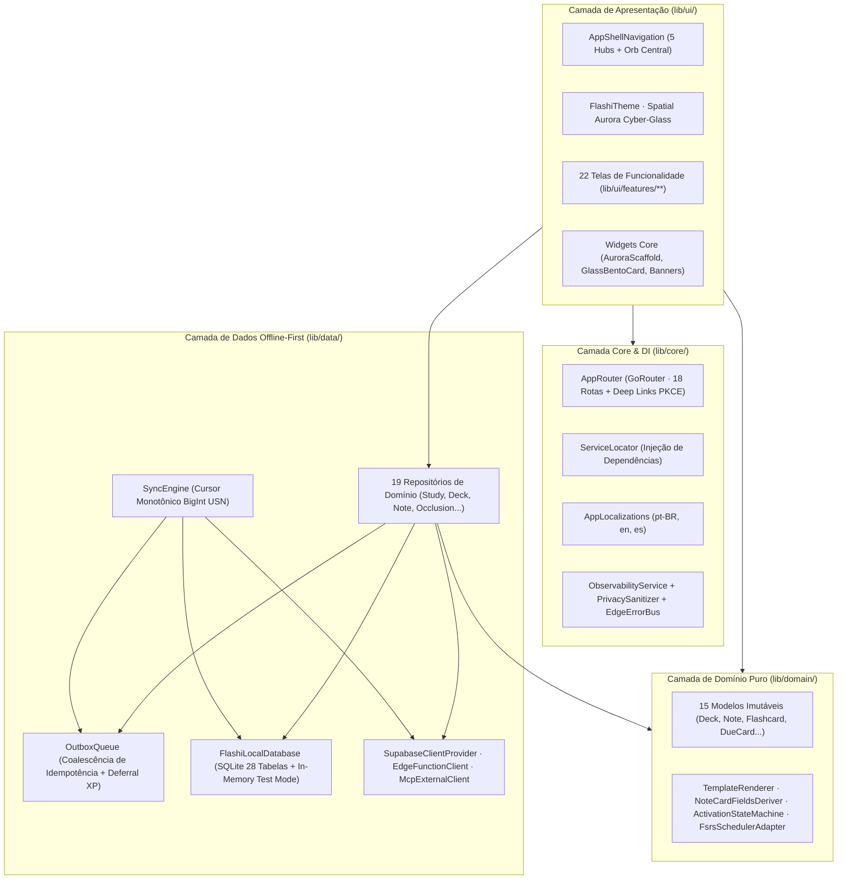

# 01. Arquitetura Limpa (Clean Architecture + MVVM) e Modelo de Domínio — Flashi Mobile

Este documento detalha a arquitetura de engenharia de software do **Flashi Mobile (Flutter)**, seu grafo de dependências, os 15 modelos de domínio imutáveis e os 3 serviços puros de domínio que garantem paridade funcional 1:1 com o aplicativo web `barrosrafa/app-flashi`.

---

## 1. Visão Macro da Arquitetura em 4 Camadas

O projeto segue **Clean Architecture** combinada ao padrão **MVVM Reativo (`ChangeNotifier` + `ListenableBuilder`)** recomendado pelo time oficial do Flutter:

### Princípios Arquiteturais Inegociáveis
1. **Latência Zero na Revisão (`< 16ms` / 60-120fps):** Toda avaliação de cartão (`Again`, `Hard`, `Good`, `Easy`) calcula o novo estado FSRS-6 localmente em Dart via [`StudyRepository`](file:///Users/rafaelaparecido/projects/flashcards-flutter/lib/data/repositories/study_repository.dart), grava imediatamente no [`FlashiLocalDatabase`](file:///Users/rafaelaparecido/projects/flashcards-flutter/lib/data/local/app_database.dart) e enfileira a sincronização remota de forma assíncrona.
2. **Isolamento Estrito entre Contas ([`LocalUserScope`](file:///Users/rafaelaparecido/projects/flashcards-flutter/lib/data/local/local_user_scope.dart)):** Sempre que o `user_id` autenticado muda ou ocorre sign-out explícito, todas as 28 tabelas locais, a `outbox_queue` e o cursor `last_usn` são purgados antes de hidratar a nova sessão.
3. **Bootstrap Offline Resiliente ([`OfflineIdentityStore`](file:///Users/rafaelaparecido/projects/flashcards-flutter/lib/data/local/offline_identity.dart)):** Armazena a última identidade autenticada no Keychain (iOS) / Keystore (Android) via `flutter_secure_storage`, permitindo abrir o app e estudar em modo avião sem exigir handshake de rede.

---

## 2. Catálogo Completo dos Modelos de Domínio (`lib/domain/models/`)

| Arquivo | Classes / Enums | Responsabilidade e Regras de Negócio |
| :--- | :--- | :--- |
| [deck.dart](file:///Users/rafaelaparecido/projects/flashcards-flutter/lib/domain/models/deck.dart) | `Deck`, `DeckVisibility`, `DeckSettings`, `DeckCollaborator`, `CollaborationInvite` | Suporta hierarquia de até 5 níveis via `parentDeckId`, visibilidade (`private`, `unlisted`, `public`), overrides FSRS por deck e controle de acesso colaborativo (`viewer`, `editor`, `owner`). |
| [note.dart](file:///Users/rafaelaparecido/projects/flashcards-flutter/lib/domain/models/note.dart) | `Note`, `NoteInput`, `NoteClozeDeletion`, `NoteReference` | Representa a unidade semântica geradora de cartões (`basic`, `reversed`, `cloze`, `image_occlusion`), com `fieldValues` chave-valor, `checksum` SHA-1 de deduplicação e referências bidirecionais entre notas. |
| [flashcard.dart](file:///Users/rafaelaparecido/projects/flashcards-flutter/lib/domain/models/flashcard.dart) | `Flashcard`, `Tag`, `CardMedia` | Cartão concreto derivado de uma `Note` com ordinal `cardOrd`, estados `isSuspended`/`isBuried`, tags associadas e metadados de mídia privada no bucket `card-media`. |
| [due_card.dart](file:///Users/rafaelaparecido/projects/flashcards-flutter/lib/domain/models/due_card.dart) | `DueCard`, `demoCards` | Projeção otimizada para a fila de estudo diário contendo parâmetros FSRS-6 (`stability`, `difficulty`, `reps`, `lapses`, `state`, `dueDate`) e fixture de demonstração interativa. |
| [review_result.dart](file:///Users/rafaelaparecido/projects/flashcards-flutter/lib/domain/models/review_result.dart) | `ReviewRating`, `ReviewResponse` | Enumeração dos 4 níveis FSRS (`again=1`, `hard=2`, `good=3`, `easy=4`) e resposta consolidada do motor de agendamento. |
| [card_template.dart](file:///Users/rafaelaparecido/projects/flashcards-flutter/lib/domain/models/card_template.dart) | `CardTemplate`, `TemplateField`, `CardGenerationRule`, `RenderedCard` | Definição de modelos customizados compatíveis com sintaxe Anki (`{{Field}}`, `{{#Cond}}`, `{{cloze:Text}}`, `{{type:Field}}`). |
| [occlusion_mask.dart](file:///Users/rafaelaparecido/projects/flashcards-flutter/lib/domain/models/occlusion_mask.dart) | `OcclusionMask`, `OcclusionCreationResult` | Máscaras retangulares normalizadas em coordenadas percentuais canônicas (`0.0 <= x, y, width, height <= 100.0`) independentes da resolução da tela. |
| [deck_exam.dart](file:///Users/rafaelaparecido/projects/flashcards-flutter/lib/domain/models/deck_exam.dart) | `DeckExam`, `ExamPriority`, `ExamStatus` | Alvo de prova com data limite, retenção desejada ($0.70 \dots 0.99$) e cálculo dinâmico do multiplicador de compressão de intervalo FSRS ($1.0 \le m \le 2.5$). |
| [gamification.dart](file:///Users/rafaelaparecido/projects/flashcards-flutter/lib/domain/models/gamification.dart) | `GamificationProfile`, `BadgeDefinition`, `UserBadge`, `SessionXpResult`, `LeaderboardEntry` | Progressão de XP, cálculo de nível ($\lfloor\sqrt{\text{XP}/100}\rfloor + 1$), ofensiva diária (`currentStreak`), bloqueadores de ofensiva (`streakFreezesAvailable`), insígnias e ranking global. |
| [socratic_session.dart](file:///Users/rafaelaparecido/projects/flashcards-flutter/lib/domain/models/socratic_session.dart) | `SocraticSession`, `SocraticMessage`, `SocraticStatus` | Sessão de tutoria socrática guiada por IA (`started`, `in_progress`, `resolved`, `abandoned`) disparada quando o estudante erra um cartão. |
| [ingestion_job.dart](file:///Users/rafaelaparecido/projects/flashcards-flutter/lib/domain/models/ingestion_job.dart) | `IngestJob`, `IngestionSourceType`, `ImportFormat`, `ImportDeckResult`, `ImportJob` | Jobs assíncronos de síntese de cartões via IA (`pdf`, `youtube`, `webpage`, `markdown`, `text`, `audio`) e importação estruturada (`csv`, `tsv`, `txt`, `json`, `markdown`, `xml`). |
| [anki_transfer.dart](file:///Users/rafaelaparecido/projects/flashcards-flutter/lib/domain/models/anki_transfer.dart) | `AnkiImportResult`, `AnkiExportResult` | Estatísticas detalhadas de importação e exportação de pacotes `.apkg` e `.colpkg` via bucket `anki-transfers`. |
| [analytics_summary.dart](file:///Users/rafaelaparecido/projects/flashcards-flutter/lib/domain/models/analytics_summary.dart) | `AnalyticsDay`, `AnalyticsData`, `DeckRetentionPoint`, `FsrsOptimizationStatus` | Série histórica diária de revisões, taxa de retenção verdadeira (`true_retention_rate`) e vetor padrão/otimizado de 21 pesos FSRS-6. |
| [learning_preferences.dart](file:///Users/rafaelaparecido/projects/flashcards-flutter/lib/domain/models/learning_preferences.dart) | `LearningGoal`, `LearningPreferences`, `LearningDraft`, `OnboardingState`, `ActivationResult` | Preferências de onboarding (`vestibular`, `idiomas`, `concursos`, `carreira`), ritmo diário (`5`, `15` ou `30` min) e rascunhos curados de Starter Decks. |
| [user_profile.dart](file:///Users/rafaelaparecido/projects/flashcards-flutter/lib/domain/models/user_profile.dart) | `UserProfile`, `StudySettings`, `ProfileData`, `StudySettingsInput` | Perfil do usuário (`locale`, `timezone`, `theme`, `onboardingCompleted`) e limites globais FSRS-6 (`dailyNewCardsLimit`, `dailyReviewsLimit`, `desiredRetention`, `dayBoundaryHour`). |

---

## 3. Serviços Puros de Domínio (`lib/domain/services/`)

### 3.1 [`TemplateRenderer`](file:///Users/rafaelaparecido/projects/flashcards-flutter/lib/domain/services/template_renderer.dart)
Motor determinístico de renderização de cartões compatível com Anki e Flashi:
1. **`{{FrontSide}}`**: Substitui no template de verso o HTML/Markdown já renderizado na frente.
2. **Condicionais Positivas (`{{#Campo}}...{{/Campo}}`)**: Renderiza o bloco interno somente se `fields['Campo']` não estiver vazio.
3. **Condicionais Negativas (`{{^Campo}}...{{/Campo}}`)**: Renderiza o bloco interno somente se `fields['Campo']` estiver vazio.
4. **Omissão Cloze (`{{cloze:Text}}` e `{{c1::resposta::dica}}`)**:
   - Na frente (`side == 'front'`), substitui o índice ativo `activeClozeIndex` por `[...dica...]` ou `[...]` e exibe o texto normal das demais lacunas inativas (`c2`, `c3`, etc.).
   - No verso (`side == 'back'`), destaca a resposta revelada da lacuna ativa como `**[resposta]**`.
5. **Digitação Ativa (`{{type:Field}}`)**: Injeta marcador interativo `[TYPE:Field]` na frente e o gabarito esperado no verso.

### 3.2 [`NoteCardFieldsDeriver`](file:///Users/rafaelaparecido/projects/flashcards-flutter/lib/domain/services/note_card_fields_deriver.dart)
Converte um `NoteInput` em uma lista de `DerivedCardDefinition`:
- **`basic`**: Gera 1 cartão (`ord = 0`, `front -> back`).
- **`reversed` / `basic_reversed`**: Gera 2 cartões (`ord = 0` `front -> back` e `ord = 1` `back -> front`).
- **`cloze`**: Extrai todos os índices distintos `c1..cN` via `TemplateRenderer.extractClozeIndices` e gera $N$ cartões (`ord = clozeIndex - 1`), um para cada índice Cloze.
- **`image_occlusion`**: Gera 1 cartão por máscara retangular desenhada na imagem.

### 3.3 [`ActivationStateMachine`](file:///Users/rafaelaparecido/projects/flashcards-flutter/lib/domain/services/activation_state_machine.dart)
Máquina de estados finita que governa a jornada de ativação do novo usuário:
`uninitialized` $\rightarrow$ `selectingGoal` $\rightarrow$ `provisioningStarterDeck` $\rightarrow$ `firstStudySession` (5 cartões iniciais) $\rightarrow$ `completed`.

### 3.4 [`FsrsSchedulerAdapter`](file:///Users/rafaelaparecido/projects/flashcards-flutter/lib/domain/services/fsrs_scheduler_adapter.dart)
Adaptador determinístico do motor FSRS-6 que encapsula a biblioteca `fsrs` e garante unificação matemática 1:1 entre a exibição prévia de intervalos na UI (`previewIntervals`) e a submissão de avaliações no repositório de estudo (`submitReview`). Hidrata campos da tabela `card_learning_state` (`stability`, `difficulty`, `reps`, `lapses`, `state`), computa fallbacks matemáticos na ausência de histórico e aplica compressão dinâmica de exames ($1.0 \le m \le 2.5$).
