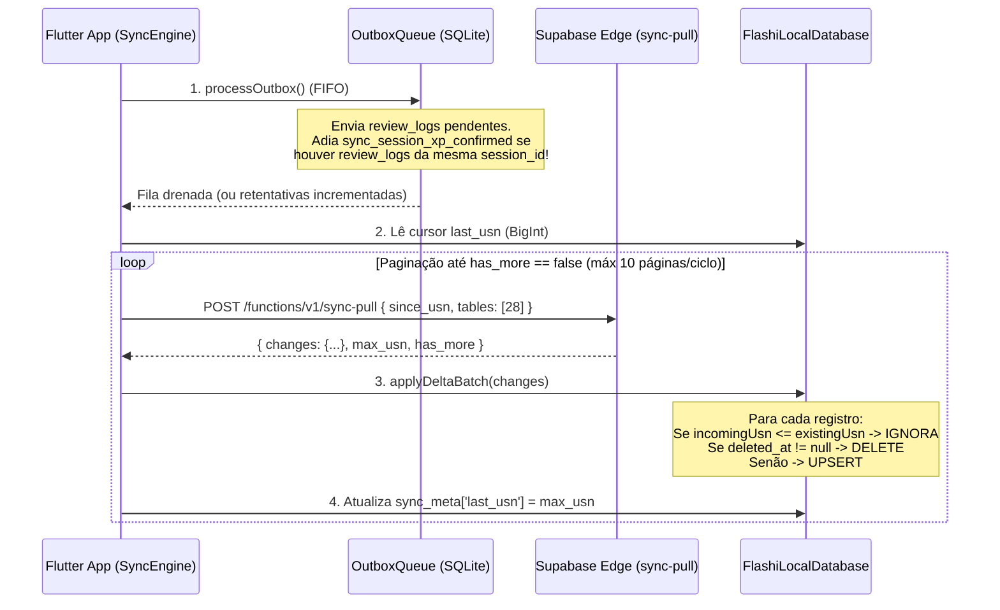

# 02. Motor Offline-First, Sincronização USN (`BigInt`) nas 28 Tabelas e Outbox Queue

Este documento especifica o funcionamento interno da camada de persistência local ([`FlashiLocalDatabase`](file:///Users/rafaelaparecido/projects/flashcards-flutter/lib/data/local/app_database.dart)), da fila de mutações offline ([`OutboxQueue`](file:///Users/rafaelaparecido/projects/flashcards-flutter/lib/data/local/outbox_queue.dart)) e do motor de sincronização incremental por cursor `BigInt` **USN (Update Sequence Number)** ([`SyncEngine`](file:///Users/rafaelaparecido/projects/flashcards-flutter/lib/data/local/sync_engine.dart)).

---

## 1. As 28 Tabelas Sincronizadas (`SyncTables.allTables`)

Definidas em [`lib/data/local/tables/sync_tables.dart`](file:///Users/rafaelaparecido/projects/flashcards-flutter/lib/data/local/tables/sync_tables.dart), espelhando exatamente a constante `SYNC_TABLES` de `src/lib/local/sync.ts` no `app-flashi`:

| # | Tabela | Chave Primária Local (`extractRowKey`) | Domínio |
| :--- | :--- | :--- | :--- |
| 1 | `decks` | `id` | Hierarquia de baralhos (até 5 níveis) |
| 2 | `notes` | `id` | Notas base geradoras de cartões |
| 3 | `note_card_definitions` | `id` | Regras de derivação nota $\rightarrow$ cartão |
| 4 | `note_cloze_deletions` | `id` | Lacunas Cloze `{{c1::...}}` extraídas |
| 5 | `note_references` | `id` | Grafo bidirecional de links entre notas |
| 6 | `note_image_occlusion_boxes` | `id` | Máscaras percentuais `[0..100]` de oclusão |
| 7 | `cards` | `id` | Flashcards concretos (`basic`, `cloze`, `occlusion`) |
| 8 | `card_tags` | `card_id:tag_id` *(composta)* | Associação N:N entre cartões e tags |
| 9 | `card_media` | `id` | Metadados de arquivos no bucket `card-media` |
| 10 | `card_learning_state` | `user_id:card_id` *(composta)* | Estado FSRS-6 (`stability`, `difficulty`, `due_date`) |
| 11 | `card_templates` | `id` | Modelos customizados de nota/cartão |
| 12 | `field_definitions` | `id` | Campos pertencentes a um `card_template` |
| 13 | `tags` | `id` | Tags organizacionais do usuário |
| 14 | `review_logs` | `id` | Histórico imutável de avaliações FSRS-6 |
| 15 | `study_settings` | `user_id` *(composta)* | Configurações globais de estudo do usuário |
| 16 | `user_deck_settings` | `user_id:deck_id` *(composta)* | Overrides de limites e retenção por baralho |
| 17 | `daily_statistics` | `user_id:date` *(composta)* | Telemetria agregada por dia de estudo |
| 18 | `fsrs_optimization_runs` | `id` | Histórico de calibrações dos 21 pesos FSRS-6 |
| 19 | `deck_collaborators` | `id` | Permissões de compartilhamento (`viewer`, `editor`) |
| 20 | `deck_exams` | `id` | Provas agendadas para o Modo Prova (Exam Boost) |
| 21 | `user_gamification_profiles` | `user_id` *(composta)* | XP total, nível, ofensiva atual e freezes |
| 22 | `user_badges` | `id` | Insígnias desbloqueadas pelo estudante |
| 23 | `badges_definition` | `id` | Catálogo global de conquistas |
| 24 | `socratic_remediation_sessions` | `id` | Diálogos de tutoria socrática por IA |
| 25 | `ai_ingestion_jobs` | `id` | Jobs de geração de cartões via IA |
| 26 | `anki_transfer_jobs` | `id` | Jobs de importação/exportação `.apkg`/`.colpkg` |
| 27 | `profiles` | `id` | Perfil, idioma, fuso horário e status de onboarding |
| 28 | `mcp_tool_audit` | `id` | Trilha de auditoria de chamadas MCP externas |

---

## 2. Algoritmo de Sincronização Monotônica por `BigInt` USN

O protocolo de sincronização em [`SyncEngine`](file:///Users/rafaelaparecido/projects/flashcards-flutter/lib/data/local/sync_engine.dart) garante consistência eventual livre de perda de dados mesmo sob conexões móveis instáveis (3G/4G/metrô):

### Regra de Resolução de Conflitos (`applyDeltaBatch`)
Para cada linha recebida de `sync-pull`:
$$\text{Se } \text{USN}_{\text{recebido}} > 0 \land \text{USN}_{\text{local}} > 0 \land \text{USN}_{\text{recebido}} \le \text{USN}_{\text{local}} \implies \text{Descarta atualização obsoleta}$$
Caso contrário:
- Se `record['deleted_at'] != null` (**Tombstone**): remove o registro local (`deleteRow`).
- Se `record['deleted_at'] == null`: aplica `upsertRow` preservando a chave composta ou `id`.

---

## 3. Coalescência de Idempotência e Deferral na `OutboxQueue`

Implementada em [`lib/data/local/outbox_queue.dart`](file:///Users/rafaelaparecido/projects/flashcards-flutter/lib/data/local/outbox_queue.dart), a fila offline possui três garantias críticas:

1. **Deduplicação de `review_logs` por `idempotency_key`:**
   Se a mesma avaliação de cartão for enfileirada mais de uma vez com o mesmo UUIDv4 `idempotency_key`, a `OutboxQueue` atualiza o item existente no lugar de duplicar a linha.
2. **Deduplicação de `sync_session_xp_confirmed` por `p_session_id`:**
   Múltiplas chamadas de confirmação de XP para a mesma sessão de estudo (`p_session_id`) são fundidas em uma única operação RPC na fila.
3. **Adiamento por Dependência (`Session XP Deferral`):**
   A RPC `sync_session_xp_confirmed` valida no PostgreSQL os `review_logs` já persistidos para aquela sessão. Portanto, se qualquer item de `review_logs` com o mesmo `session_id` ainda estiver pendente ou tiver falhado na passagem atual da `OutboxQueue`, a execução de `sync_session_xp_confirmed` é **automaticamente adiada** para o próximo ciclo de sync, evitando perda de XP.
